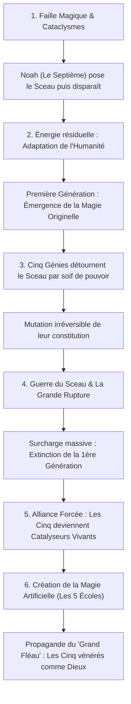

# 03 - Synthèse Narrative Définitive : L'Épopée d'Haxolot

> **Échelle du monde** : La Terre — Le Continent Scellé (le sanctuaire des Cinq Écoles) vs Les Terres Extérieures (les terres délaissées des exilés).  
> **Type de document** : Lore officiel unifié & Bible de développement.  
> **Auteurs** : Ousmane & Équipe Haxolot.

---

## 1. La Genèse & La Vérité Secrète du Passé (Le Socle Historique)

### Étape 1 : Le Premier Cataclysme & Le Sceau de Noah
* Une gigantesque faille magique déchire la Terre, déclenchant des cataclysmes mondiaux.
* Après deux ans de désolation, un prodige nommé **Noah** parvient à concevoir un sceau d'une complexité absolue et referme la brèche.
* Dès le sceau posé, **Noah disparaît sans laisser de trace**, sans jamais chercher à régner. Dans les textes anciens, il est énigmatiquement désigné comme **« Le Septième »**.

### Étape 2 : L'Énergie Résiduelle & La Première Génération
* Le sceau n'étant pas hermétique, une énergie subtile filtre continuellement.
* Au fil des siècles, l'humanité s'y adapte biologiquement.
* Naît alors la **Première Génération**, capable de manipuler la **Magie Originelle**. De grands royaumes fleurissent sur Terre.

### Étape 3 : Les Cinq Génies & Le Péché d'Avidité
* Au sein de chaque royaume émerge un génie d'exception (les futurs Cinq).
* Déchiffrant les vestiges de Noah, ils localisent le sceau et, poussés par l'ambition, le manipulent pour siphonner la puissance brute de la faille.
* Ce contact direct altère irréversiblement leur chair et leur métabolisme, les rendant surpuissants mais biologiquement mutants.

### Étape 4 : La Guerre du Sanctuaire & La Grande Rupture
* Une guerre d'armées éclate entre les nations pour le contrôle territorial du sceau.
* Sous l'effet combiné de la ponction excessive des Cinq et de la violence des combats, le sceau cède brutalement : c'est **La Grande Rupture**.
* La déflagration d'énergie originelle pure est si titanesque que tous les combattants sont pulvérisés, et l'ensemble de la Première Génération périt, incapable d'encaisser une telle saturation. Les cataclysmes reprennent.

### Étape 5 : L'Alliance Désespérée des Cinq Catalyseurs
* Seuls les Cinq Génies survivent à l'onde de choc grâce aux mutations préalables de leurs corps.
* Face à une Terre condamnée où personne ne peut survivre, ils s'allient une seule et dernière fois par pur instinct de conservation.
* Ne sachant pas recréer le sceau de Noah, ils enchaînent leurs propres corps altérés pour servir de **catalyseurs vivants**. Ils sont **toujours vivants** aujourd'hui, cloués au cœur de sanctuaires secrets pour brider la faille.

### Étape 6 : La Magie Artificielle & Le Mensonge du « Grand Fléau »
* Détenant le monopole de la magie originelle, les Cinq conçoivent pour les survivants un système magique synthétique et bridé : **la Magie Artificielle**.
* Ils réécrivent l'histoire de A à Z : ils effacent leur cupidité et font croire au peuple qu'ils ont sauvé le monde d'une punition divine appelée **« Le Grand Fléau »**.
* La nouvelle humanité (la Seconde Génération) grandit dans l'illusion totale : pour eux, cette magie est naturelle et sacrée, et les Cinq sont des dieux vivants bienfaiteurs.

---

## 2. Les 7 Principes de l'Énergie Primordiale

Toute l'énergie provient de la faille. La Première Génération baignait dans cette énergie pure sans intermédiaire. Lorsque les Cinq sont devenus les catalyseurs vivants de la faille, ils ont **monopolisé le contact direct avec l'énergie pure**. Le reste du monde ne reçoit désormais l'énergie que filtrée et déformée par ces catalyseurs.

Ayant une compréhension partielle du scellement de Noah, chaque Génie s'est approprié un principe physique de manipulation de l'énergie :

| N° | Entité | Principe Fondamental | Rôle & Manifestation en Combat |
| :---: | :--- | :--- | :--- |
| **1** | **1er Génie** | **Aspirer** | Siphonne et absorbe l'énergie ambiante, draine les forces adverses. |
| **2** | **2ème Génie** | **Altérer** | Modifie la nature même de l'énergie (chaleur, foudre, acidité, corruption). |
| **3** | **3ème Génie** | **Condenser** | Densifie l'énergie pour créer une masse inébranlable, boucliers et impacts lourds. |
| **4** | **4ème Génie** | **Accélérer** | Multiplie la vélocité de l'énergie (vitesse pure, dashs fulgurants, frappes éclair). |
| **5** | **5ème Génie** | **Projeter** | Éjecte et repousse l'énergie à distance (ondes de choc, rafales cinétiques). |
| **6** | **Le Sixième (Héros)** | **Guider** | Capacité exclusive au protagoniste : orienter, courber et piloter le flux brut librement pour assembler les principes. |
| **7** | **Le Septième (Noah)** | **Sceller** | Le pouvoir ultime : verrouiller, contraindre et fermer hermétiquement la faille. |

---

## 3. L'Éveil du Sixième & Le Destin du Joueur

### A. Qui est le Protagoniste ?
* Un jeune paria issu des Terres Extérieures. Sa mère agonise, rongée par la maladie magique des terres d'exil.
* Pour payer son remède, il est recruté comme mercenaire jetable par un marchand affilié à l'Organisation du Continent.
* Ses missions : éliminer des "hérétiques" (en réalité des érudits qui ont découvert le mensonge du Grand Fléau).

### B. La Trahison & L'Éveil du Sixième
* Trahi par l'Organisation une fois les missions achevées, le héros découvre que le remède était un mensonge.
* Au bord de la mort, son refus absolu de capituler déclenche une résonance spirituelle avec son **Double des Limbes**.
* Pour la première fois depuis des siècles, un mortel réveille la **Magie Originelle** autonome, sans passer par la magie artificielle des Cinq !
* C'est la panique pour les Cinq : ils découvrent avec terreur qu'un **« Sixième »** existe, brisant leur prétention d'être le sommet indépassable du monde.

---

## 4. Boss Design : Le Double Affrontement des Cinq

Pour servir parfaitement votre gameplay hybride (Exploration Top-Down + Duel latéral façon *Sekiro*) :

1. **Phase 1 : Le Corps-Réacteur (Top-Down Action)** :  
   Dans les cryptes secrètes du Continent, le héros affronte le corps primitif hypertrophié du Précurseur (une monstruosité mutée enchaînée à la faille). Sa destruction coupe l'alimentation en énergie de l'École correspondante.
2. **Phase 2 : Le Maître Réincarné (Duel Latéral 2D - Sabre & Parade)** :  
   L'âme du Précurseur, furieuse et privée de son réacteur, affronte le héros sous sa forme humaine réincarnée dans un duel de sabre technique sans merci, où la parade et la déviation de posture sont obligatoires.

---

## 5. Le Grimoire des 7 Branches (Progression Gameplay)

* **Branches 1 à 5** : Le héros s'approprie les sorts des Cinq Écoles en les "blasphémant" (il y grave son propre nom à la place des faux dieux).
* **Branche 6** : Sorts de Magie Originelle pure créés avec son Double des Limbes.
* **Branche 7 (Le Sceau de Noah)** : La boucle se boucle. Le grimoire complété par le Sixième traversera le temps pour atterrir entre les mains de Noah dans le passé, lui permettant de créer le Sceau originel !