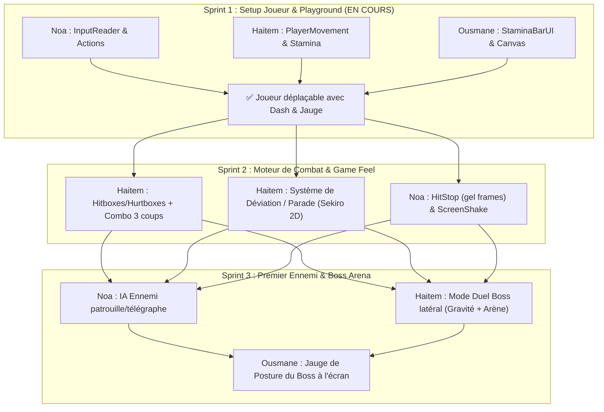

# Roadmap, Équipe & Guide d'Action Concret — Haxolot

> **Genre** : Action-RPG Aventure 2D Pixel Art  
> **Hybride** : Exploration Top-Down 3/4 + Boss en duel latéral (Fighter / Sekiro 2D)  
> **Narration** : Monde vivant, civilisations actives, dialogues scénarisés et cinématiques de mise en scène  
> **Moteur** : Unity 6 (URP 2D, New Input System, Aseprite)  
> **Dépôt UVC** : `/main@haxolot/haxolot@geryonhaitem@unity`

---

## 👥 Rôles & Responsabilités

| Membre | Rôle | Mission Concrète |
| :--- | :--- | :--- |
| **Haitem** | **Lead Dev & Physique/Combat** | Code le GameObject `Player`, la physique 2D (`Rigidbody2D`), le mouvement, l'endurance et le système de combat (hitboxes, i-frames, parade). |
| **Noa** | **Senior Dev, Input & Game Feel** | Configure le **New Input System**, le script `InputReader`, la caméra **Cinemachine 2D**, et les feedbacks d'impacts (HitStop, Shake). |
| **Ousmane** | **Gameplay Dev, Data & UI** | Crée le Canvas UI (barres de vie/stamina), les `ScriptableObjects` (armes, items, lore), et les triggers d'interaction dans le monde. |
| **Antigravity (IA)** | **Copilote Dev** | Fournit le code C# prêt à l'emploi, les gabarits, vérifie les standards et pousse sur UVC. |

---

## 🚀 SPRINT 1 : Guide Pas-à-Pas Concret (À faire MAINTENANT)

Ce sprint pose le personnage jouable dans une scène de test **Playground**.  
**Critère de réussite (Definition of Done) :**  
En appuyant sur Play, on déplace un carré joueur au clavier (ZQSD / Flèches) ou au joystick, la caméra le suit avec fluidité, une jauge d'endurance diminue quand on dash et se recharge automatiquement.

---

### 🟢 Étape 1 : Noa — Setup Input System & Caméra

#### 1.1 Action Map (`Assets/Settings/InputSystem_Actions.inputactions`)
Vérifier ou ajouter les actions suivantes dans la map **Player** :
* **Move** : `Value` / `Vector2` (Composites ZQSD + Stick gauche manette).
* **Dash** : `Button` (Touche `Space` / Bouton `A` ou `B` manette).
* **Attack** : `Button` (Clic gauche / Bouton `X` manette).
* **Parry** : `Button` (Clic droit / Bouton `LB` ou `LT` manette).
* **Interact** : `Button` (Touche `E` / Bouton `Y` manette).

#### 1.2 Script `InputReader.cs` (`Assets/_Project/Scripts/Core/InputReader.cs`)
* Doit exposer des événements C# propres :
  * `public event Action<Vector2> OnMoveEvent;`
  * `public event Action OnDashEvent;`
  * `public event Action OnAttackEvent;`
  * `public event Action OnParryEvent;`
  * `public event Action OnInteractEvent;`

#### 1.3 Caméra de suivi
* Dans la scène `Playground`, ajouter une **Cinemachine Camera 2D**.
* Assigner le GameObject `Player` dans le champ `Follow`.
* Régler le **Damping** (X: 0.5, Y: 0.5) pour un suivi doux.

---

### 🔵 Étape 2 : Haitem — Physique & Mouvement Joueur

#### 2.1 Hiérarchie du GameObject `Player` dans la scène
Créer le GameObject suivant :
```text
Player (Tag: "Player", Layer: "Entities")
├── SpriteRenderer (Sprite carré blanc, Sorting Layer: "Entities", Order: 0)
├── Rigidbody2D :
│   ├── Body Type: Dynamic
│   ├── Gravity Scale: 0 (mode Top-Down pour l'exploration)
│   ├── Collision Detection: Continuous
│   ├── Interpolate: Interpolate
│   └── Constraints: Freeze Rotation Z (Coché !)
├── CapsuleCollider2D ou BoxCollider2D (taille adaptée au sprite, offset au niveau des pieds)
├── PlayerController.cs (Stats vitales : Vie, Stamina auto-regen, gestion des événements)
└── PlayerMovementTopDown.cs (Déplacement 8 directions + Dash intégré avec i-frames)
```
*Une fois le GameObject monté, le glisser dans `_Project/Prefabs/Characters/` pour créer le `Player.prefab`.*

#### 2.2 Spécifications du script `PlayerMovementTopDown.cs`
* **Variables sérialisées** :
  * `[SerializeField] private float moveSpeed = 6f;`
  * `[SerializeField] private float acceleration = 50f;`
  * `[SerializeField] private float deceleration = 60f;`
* **Logique physique dans `FixedUpdate` (Unity 6)** :
  * Utiliser `rb.linearVelocity` (propriété Unity 6 qui remplace `rb.velocity`).
  * Interpoler la vitesse actuelle vers la vitesse cible avec `Vector2.MoveTowards` pour un arrêt net sans effet patinoire.

#### 2.3 Spécifications du script `PlayerStamina.cs`
* **Variables** :
  * `maxStamina = 100f;`
  * `currentStamina;`
  * `staminaRegenRate = 25f;` (points par seconde)
  * `regenDelay = 0.5f;` (temps d'attente avant régénération)
  * `isExhausted` (état quand la barre tombe à 0)
* **Événements** :
  * `public event Action<float, float> OnStaminaChanged;` (transmet `current`, `max`)

#### 2.4 Spécifications du script `PlayerDodge.cs` (Dash)
* Coût : 25 stamina.
* Durée : 0.2s.
* Vitesse de dash : `moveSpeed * 2.5f`.
* Passe le joueur en invulnérable (`isInvulnerable = true`) pendant la durée du dash (i-frames).

---

### 🟡 Étape 3 : Ousmane — HUD UI & ScriptableObjects

#### 3.1 Création du HUD dans la scène `Playground`
Créer dans la hiérarchie :
```text
Canvas (Render Mode: Screen Space - Overlay, Canvas Scaler: Scale With Screen Size 1920x1080)
└── HUD
    ├── HealthBar (Fond + Jauge rouge en Image Type: Filled)
    └── StaminaBar (Fond + Jauge verte/jaune en Image Type: Filled)
```

#### 3.2 Script `StaminaBarUI.cs` (`Assets/_Project/Scripts/UI/StaminaBarUI.cs`)
* Récupère la référence de `PlayerStamina`.
* S'abonne à `OnStaminaChanged(current, max)`.
* Met à jour `fillAmount` de l'image Unity UI : `staminaImage.fillAmount = current / max;`.

#### 3.3 Gabarit `ItemDataSO.cs` (`Assets/_Project/Scripts/Data/ItemDataSO.cs`)
Créer la structure de base des objets pour le futur lore :
```csharp
[CreateAssetMenu(fileName = "NewItem", menuName = "Haxolot/Data/Item")]
public class ItemDataSO : ScriptableObject
{
    public string id;
    public string itemName;
    [TextArea(2, 4)] public string gameplayDescription;
    [TextArea(4, 10)] public string loreDescription; // Façon Dark Souls
    public Sprite icon;
}
```

---

## 📅 Planning Synthétique des Sprints Suivants



---

## 📋 Checklist Concrète d'Avancement

- [x] **Setup Dépôt & Structure** : Dossier `_Project/` configuré et pushé sur UVC (cs:2).
- [x] **Sprint 1.1 (Noa)** : `InputReader.cs` codé et lié à l'Action Map.
- [x] **Sprint 1.2 (Haitem)** : `PlayerMovementTopDown.cs` (Marche 8 directions + Dash intégré avec i-frames et accélération sans glissement).
- [x] **Sprint 1.3 (Haitem)** : `PlayerController.cs` (Gestion centrale de la Vie, de la Stamina avec auto-recharge et coordination).
- [x] **Sprint 1.4 (Ousmane)** : `StaminaBarUI.cs` & `ItemDataSO.cs` codés.
- [x] **Sprint 1.5 (Haitem)** : Assembler le GameObject et créer `Player.prefab` dans `_Project/Prefabs/Characters/`.
- [x] **Sprint 1.6 (Tous)** : Test dans la scène `Playground` (Validation manette/clavier).

### Sprint 2 : Moteur de Combat & Game Feel (EN COURS)
- [x] **Sprint 2.1 (Haitem)** : `IDamageable.cs` & `DamageData.cs` (Interface universelle de dégâts et de posture).
- [x] **Sprint 2.2 (Haitem)** : `PlayerCombat.cs` (Combo 3 coups à l'épée, buffer d'input, coût stamina, Gizmos de hitbox).
- [x] **Sprint 2.3 (Haitem)** : Système de Parade / Déviation *Sekiro* intégrée dans `PlayerCombat.cs` et `PlayerController.cs`.
- [x] **Sprint 2.4 (Noa)** : `HitStopManager.cs` (Micro-gel de frames auto-instancié) & `CameraShake.cs` (Secousses d'écran directionnelles).
- [x] **Sprint 2.5 (Ousmane)** : `TrainingDummy.cs` (Mannequin avec PV, jauge de posture Sekiro, clignotement et étourdissement *Posture Break*).
- [x] **Sprint 2.6 (Noa & Haitem)** : `EnemyController.cs` (IA du premier ennemi test avec poursuite, télégraphie visuelle, riposte et contre-choc de posture sur parade réussie).
- [ ] **Sprint 2.7 (Tous)** : Test en jeu dans `Playground` : Combo 3 coups + Déviation de l'attaque ennemie au Clic Droit !
